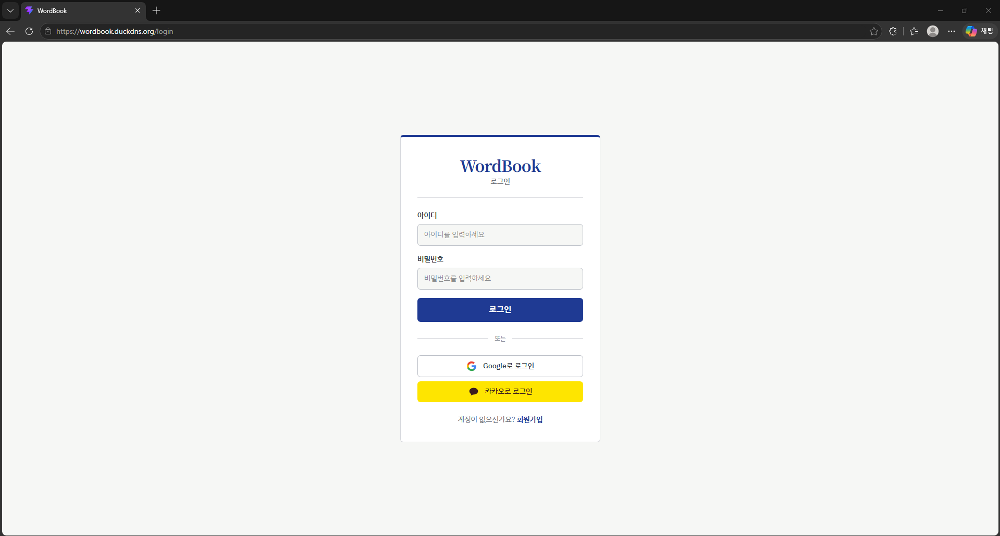
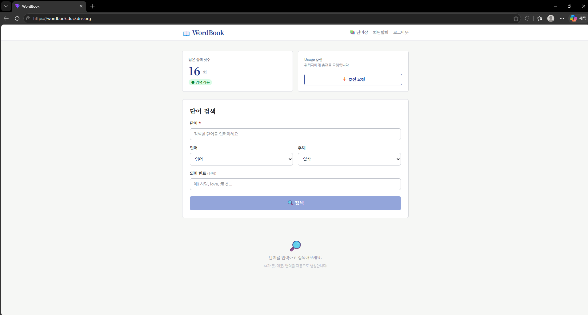
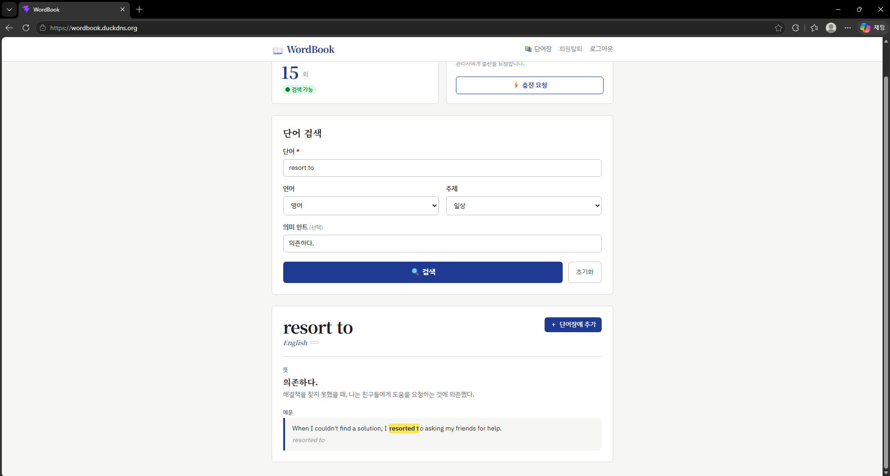
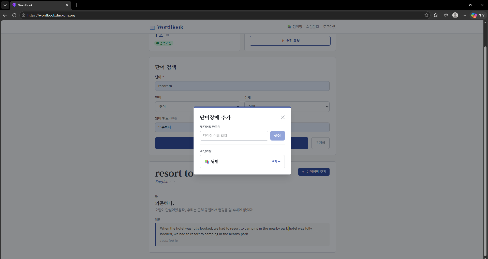
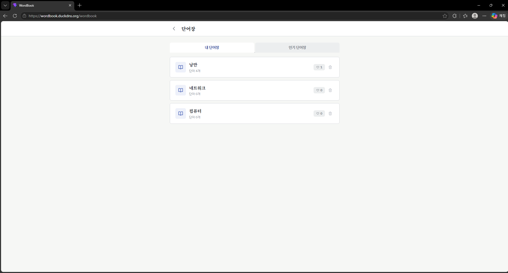
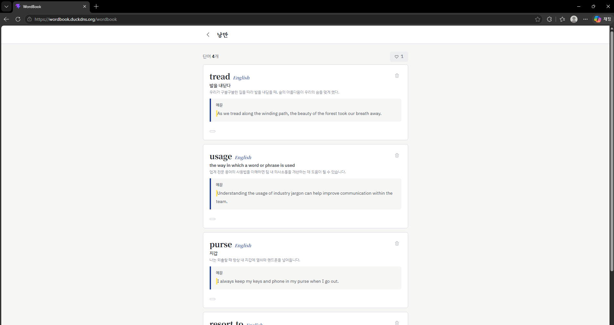

# 단어장 (Frontend)

언어와 주제를 고르면 AI가 예문을 만들어 주고, 그 단어와 예문을 나만의 단어장에 저장하는 서비스 **단어장**의 프론트엔드입니다.
전체 서비스 설명과 아키텍처는 [백엔드 레포](백엔드-레포-링크)를 참고해주세요.

🔗 데모: https://wordbook.duckdns.org

## 스크린샷

**로그인**: 아이디 로그인, Google 로그인, 카카오 로그인



**홈**: 남은 검색 횟수를 확인하고, 언어와 주제를 골라 단어를 검색합니다.



**예문 생성**: 검색한 단어의 뜻과 예문, 번역을 보여줍니다.



**단어장에 추가**: 새 단어장을 만들거나 기존 단어장에 단어를 저장합니다.



**내 단어장 목록**: 단어장별 단어 수와 좋아요 수를 보여줍니다. 인기 단어장 탭에서는 좋아요 순으로 정렬됩니다.



**단어장 상세**: 저장한 단어와 예문을 확인하고 삭제할 수 있습니다.



## 주요 기능

1. **주제별 예문 생성**: 언어(영어, 일본어, 중국어, 프랑스어, 스페인어)를 하나 고르고 주제(일상, 비즈니스, 여행, 음식, 스포츠, 기술, 문화, 기타)를 정하면 단어의 뜻, 예문, 번역을 생성합니다. 예문 안에서 검색한 단어는 형광펜으로 표시됩니다. 뜻 힌트를 함께 넣어 원하는 의미로 좁힐 수도 있습니다.
2. **나만의 단어장**: 검색한 단어와 예문을 단어장에 저장합니다. 단어장은 여러 개 만들 수 있고, 단어장과 단어는 각각 삭제할 수 있습니다.
3. **단어장 공유와 좋아요**: 다른 사람의 단어장을 열어 보고 좋아요를 누를 수 있습니다. 인기 단어장 탭에서는 좋아요 순으로 정렬된 목록을 보여줍니다.
4. **로그인과 회원가입**: Google 계정으로 로그인하거나, 일반 회원가입을 할 수 있습니다. 일반 회원가입은 이메일 인증코드를 확인해야 완료됩니다. 로그인 화면에는 카카오 로그인 버튼도 있습니다.

검색에는 사용 가능 횟수가 있고, 횟수가 없으면 홈 화면에서 충전을 요청할 수 있습니다.

## 기술 스택

- React 19, TypeScript, Vite
- React Router v7
- Axios
- Tailwind CSS v4
- 폰트: IBM Plex Sans KR, Noto Serif KR

## 실행 방법

1. 클론

   ```bash
   git clone (레포 주소)
   cd my-app
   ```

2. 패키지 설치

   ```bash
   npm install
   ```

3. 환경변수 설정 (`.env` 파일 생성)

   ```
   VITE_API_BASE_URL=http://localhost:8080
   ```

   값이 없으면 같은 출처(same-origin)로 요청합니다. Vite 개발 서버에는 프록시가 없으므로 백엔드에서 CORS를 허용해야 합니다.

4. 개발 서버 실행

   ```bash
   npm run dev
   ```

백엔드는 [백엔드 레포](백엔드-레포-링크)의 안내에 따라 먼저 실행해야 합니다.

| 명령어 | 설명 |
| --- | --- |
| `npm run dev` | 개발 서버 |
| `npm run build` | 타입 검사 후 `dist/`로 빌드 |
| `npm run preview` | 빌드 결과 미리보기 |
| `npm run lint` | ESLint |

## 프로젝트 구조

```
src/
├─ main.tsx                  # 진입점, index.css 로드
├─ App.tsx                   # BrowserRouter > AuthProvider > Routes
├─ index.css                 # Tailwind 및 디자인 토큰(색, 폰트)
├─ api/
│  └─ axiosInstance.ts       # 공용 axios 인스턴스(토큰 첨부, 401 시 재발급)
├─ auth/
│  ├─ AuthContext.tsx        # 로그인 상태, login / logout / setAccessToken
│  └─ PrivateRoute.tsx       # 로그인하지 않으면 /login으로 보내는 가드
├─ hooks/
│  └─ useAuth.ts             # AuthContext 접근 훅
└─ pages/
   ├─ LoginPage.tsx          # 로그인, 소셜 로그인
   ├─ SignupPage.tsx         # 회원가입(이메일, 인증, 정보 입력 3단계)
   ├─ OAuthCallbackPage.tsx  # 소셜 로그인 후 토큰 교환
   ├─ HomePage.tsx           # 검색 횟수, 단어 검색, 단어장에 추가
   └─ WordBookPage.tsx       # 내 단어장, 인기 단어장, 단어장 상세
```

### 라우팅

| 경로 | 화면 | 로그인 필요 |
| --- | --- | --- |
| `/login` | 로그인 | X |
| `/signup` | 회원가입 | X |
| `/oauth/callback` | 소셜 로그인 콜백 | X |
| `/` | 홈(검색) | O |
| `/wordbook` | 단어장 | O |

정의되지 않은 경로는 `/`로 이동합니다.

## 인증 방식

- 로그인하면 Access Token을 받아 `sessionStorage["accessToken"]`에 저장하고, 모든 요청에 `Authorization: Bearer <token>`으로 붙입니다.
- Refresh Token은 HttpOnly 쿠키로 관리하므로 axios에 `withCredentials: true`를 설정했습니다.
- 요청이 `401`이면 `POST /api/v2/jwt/exchange`로 토큰을 다시 받아 실패한 요청을 재시도합니다. 동시에 실패한 요청은 대기열에 두었다가 한 번에 재시도하고, 재발급에 실패하면 `/login`으로 이동합니다.
- 소셜 로그인은 `GET {API}/oauth2/authorization/google`로 이동하고, 돌아온 `/oauth/callback`에서 Refresh Token 쿠키를 Access Token으로 교환합니다.

## API 문서

프론트엔드가 호출하는 백엔드 API입니다. 기본 주소는 `VITE_API_BASE_URL`이고, 인증이 필요한 요청은 `Authorization: Bearer <accessToken>` 헤더를 사용합니다. 요청과 응답 형식은 프론트엔드 코드에서 정리한 것이므로 정확한 명세는 백엔드 레포를 기준으로 확인해주세요.

### 인증

| 메서드 | 경로 | 설명 | 요청 | 응답 |
| --- | --- | --- | --- | --- |
| POST | `/login` | 로그인 | Body `{ username, password }` | `{ accessToken }` |
| GET | `/oauth2/authorization/google` | 구글 로그인 시작(브라우저 이동) | - | 소셜 로그인 후 `/oauth/callback`으로 리다이렉트 |
| POST | `/api/v2/jwt/exchange` | Refresh Token 쿠키로 Access Token 발급 | - | `{ accessToken }` |
| POST | `/api/v2/jwt/logout` | 로그아웃(서버의 Refresh Token 삭제) | - | - |

### 회원

| 메서드 | 경로 | 설명 | 요청 | 응답 |
| --- | --- | --- | --- | --- |
| POST | `/api/v2/mail` | 이메일 인증코드 발송 | Body `{ email }` | - |
| POST | `/api/v2/mail/verify` | 인증코드 확인 | Body `{ email, code }` | `boolean` |
| POST | `/api/v2/user` | 회원가입 | Body `{ username, password, email }` | - |
| GET | `/api/v2/user/remove` | 회원 탈퇴 | - | - |

### 검색

| 메서드 | 경로 | 설명 | 요청 | 응답 |
| --- | --- | --- | --- | --- |
| GET | `/api/v2/openai/search` | 단어 뜻과 예문 생성 | Query `keyword`, `lang`, `topic`, `meaning`(선택) | `WordResult` |
| GET | `/api/v2/usage` | 남은 검색 횟수 조회 | - | `number` |
| POST | `/api/v2/usage` | 검색 횟수 충전 요청 | - | `boolean` |

`lang`에는 `English`, `Japanese`, `Chinese`, `French`, `Spanish` 중 하나를 보냅니다. 횟수를 초과하면 `400`이 반환됩니다.

```ts
interface WordResult {
  wordId: number;
  word: string;
  meaning: string;
  lang: string;
  example: string;
  topic: string;
  translation: string;
  useword: string;    // 예문의 번역
  startIndex: number; // 예문 안에서 검색어가 시작하는 위치
  lastIndex: number;  // 예문 안에서 검색어가 끝나는 위치
}
```

### 단어장

| 메서드 | 경로 | 설명 | 요청 | 응답 |
| --- | --- | --- | --- | --- |
| GET | `/api/v2/wordbook/mylist` | 내 단어장 목록 | - | `WordBookListItem[]` |
| GET | `/api/v2/wordbook/list` | 단어장 목록(인기순) | Query `page`, `size`, `sort=likeCount,desc` | `WordBookListItem[]` |
| GET | `/api/v2/wordbook` | 단어장 상세(단어 포함) | Query `id` | `WordBookDetail` |
| POST | `/api/v2/wordbook` | 단어장 생성 | Body `{ name }` | - |
| DELETE | `/api/v2/wordbook` | 단어장 삭제 | Query `id` | - |
| POST | `/api/v2/wordbookword` | 단어장에 단어 추가 | Body `{ word: wordId, wordbook: wordbookId }` | - |
| DELETE | `/api/v2/wordbookword` | 단어장에서 단어 제거 | Query `wordBookId`, `wordId` | - |
| POST | `/api/v2/wordbooklike/{wordbookId}` | 좋아요 / 취소 | - | - |

```ts
interface WordBookListItem {
  id: number;
  name: string;
  count: number;     // 단어 수
  likeCount: number;
}

interface WordBookDetail {
  id: number;
  name: string;
  likeCount: number;
  words: WordResult[];
}
```

## 배포

- (프론트 배포 방식을 한두 줄로 적어주세요)

## 참고

UI 디자인은 Claude Code를 활용해 리뉴얼했습니다. 디자인 변경은 화면 스타일과 마크업에 한정했고, API 호출, 인증, 라우팅 로직은 그대로입니다.
